# Al Bashiroh Web

The website and content management system of **Yayasan Bashiroh Robbaniyah**
in Turen, Malang, and its two schools, **SMP IT Al Bashiroh** and
**SMA IT Al Bashiroh**. One domain serves three things:

- the Yayasan site (profil, Takhosus Al-Qur'an 30 juz, keasramaan, fasilitas,
  guru & staf, berita, galeri, prestasi, kontak, dokumen);
- a portal for each school (beranda, akademik, ekstrakurikuler, prestasi,
  Q&A, and alumni for SMA);
- one PPDB registration form where applicants choose SMP or SMA.

Everything on the site is edited by the school from the admin panel. The
public copy is in Indonesian.

The application is built on [Nara](https://github.com/MasRama/nara) 3.5:
Hono and Node.js on the server, a Vue 3 single-page app in the browser, and
one SQLite database.

## Quick start

Node.js 22 or newer is required.

```bash
git clone https://github.com/MasRama/albashiroh-web.git
cd albashiroh-web
npm ci
cp .env.example .env
npm run setup
npm run dev
```

Open <http://localhost:5555>. `npm run setup` applies the migrations and
creates the first administrator, `admin@nara.local` with the temporary
password `admin12345`, which must be changed at first sign-in. Set
`NARA_ADMIN_NAME`, `NARA_ADMIN_EMAIL` and `NARA_ADMIN_PASSWORD` before setup
to choose your own.

The admin panel is at <http://localhost:5555/admin> (sign in at
`/admin/masuk`). Nobody signs up on their own: an administrator creates each
staff account under **Pengguna**, gives it a role, and sends the sign-in
details the panel prepares. A new account, and one whose password an
administrator reset, chooses its own password at first sign-in.

Photos and documents are uploaded under **Media**. A photo is turned upright,
stripped of its metadata (location included) and stored as WebP at 480, 960
and 1600 pixels wide in `storage/media/`; documents (PDF, Word, Excel,
PowerPoint) are kept as uploaded. Both are served at `/media/<id>/<file>`.

<p>
  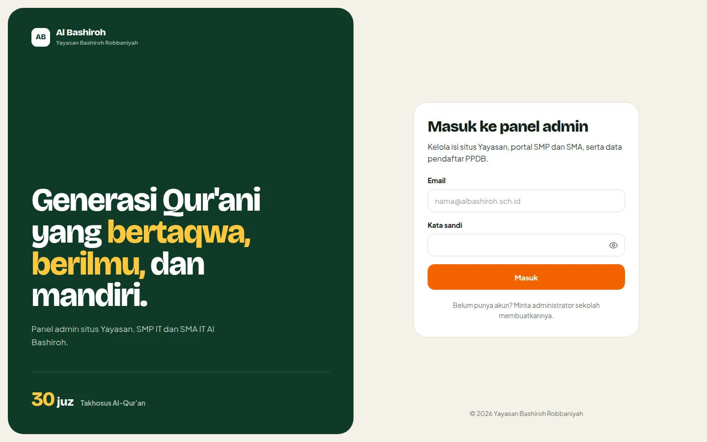
  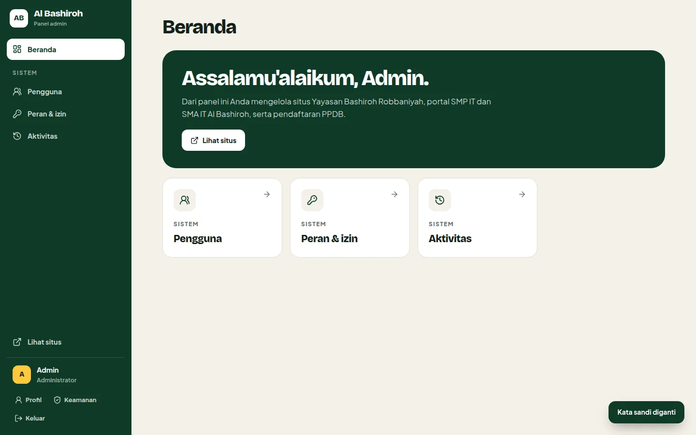
</p>
<p>
  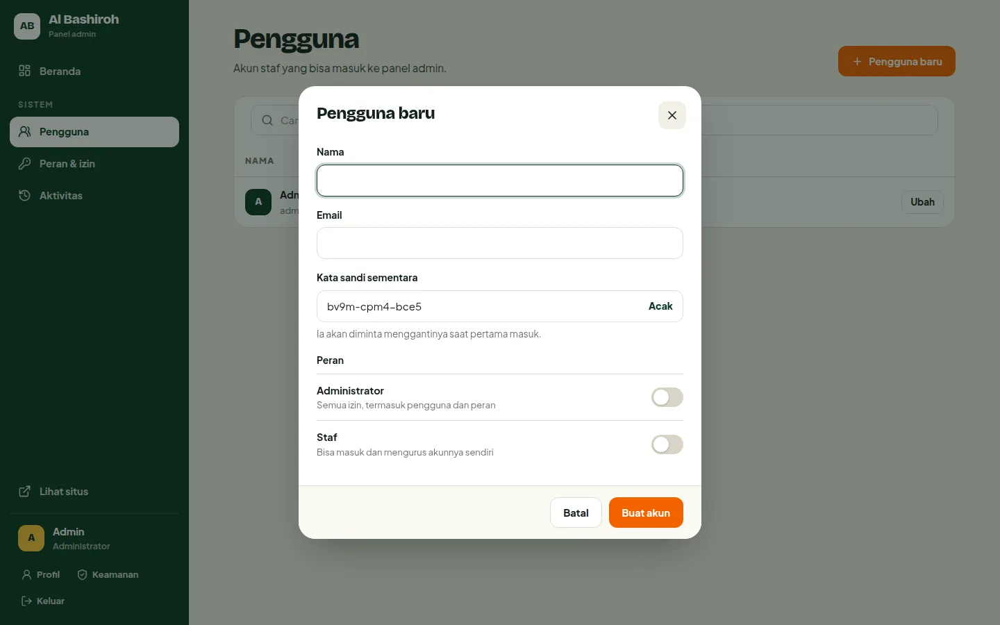
  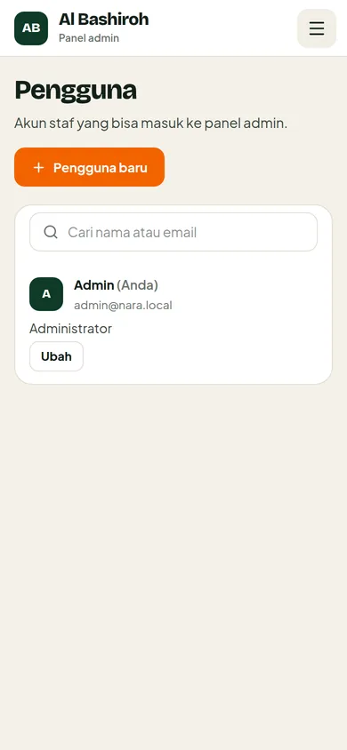
  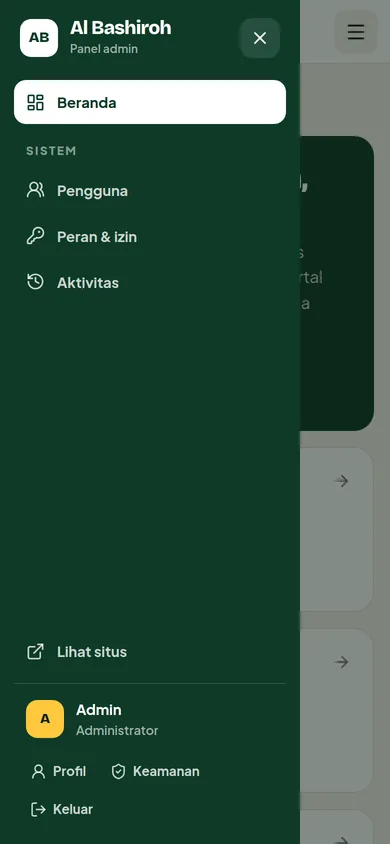
</p>
<p>
  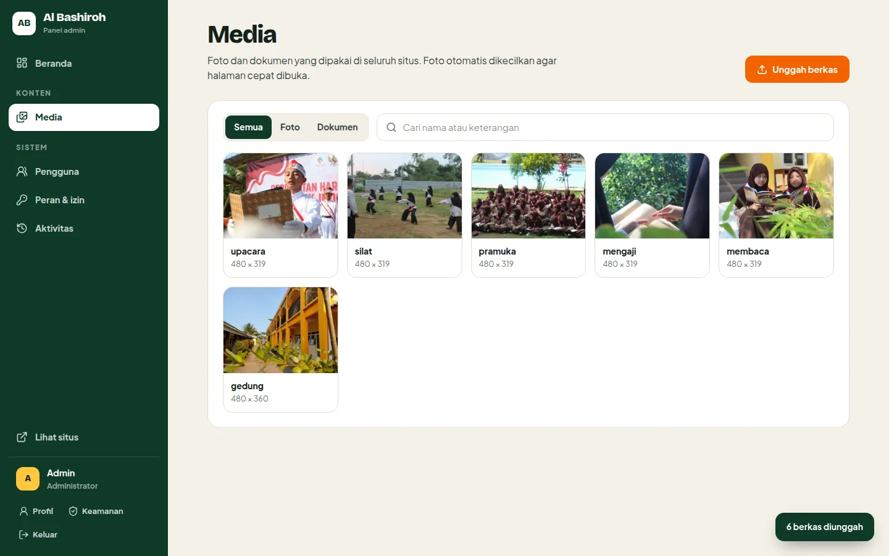
</p>

Content is written per portal: **Situs Yayasan**, **Portal SMP** and
**Portal SMA** each have news, agenda, gallery, achievements, facilities,
staff, documents, FAQ and testimonials; the schools add extracurriculars and
academics, and SMA adds alumni. An entry is a draft until it is set to
**Terbit**, then it shows on that portal's pages, and the foundation site
also lists the schools' news, agenda, gallery, achievements, facilities,
staff and documents. Each portal's **Pengaturan portal** holds its home page
text, vision and mission, profile, the principal's welcome, graduate
competencies, contact details and PPDB text. Articles are written in a
built-in editor whose output the server reduces to headings, emphasis, lists,
quotes, links and photos from the library. Roles `editor-yayasan`,
`editor-smp` and `editor-sma` give one portal each, with the media library.

Entries without a photo are counted on each portal's page and can be filtered
with **Belum ada gambar**. The public API returns such entries with no image,
never a broken path.

<p>
  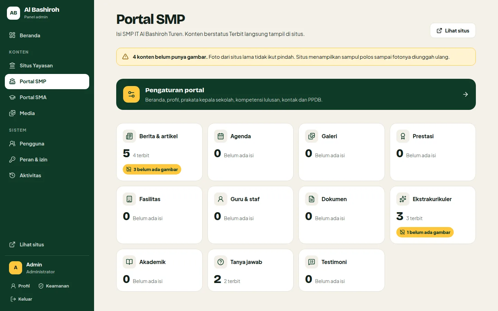
</p>
<p>
  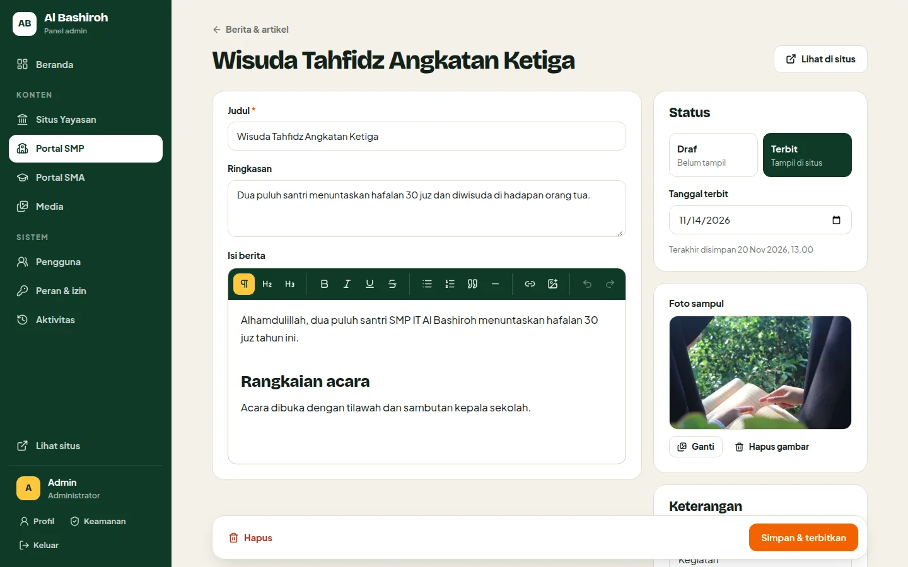
  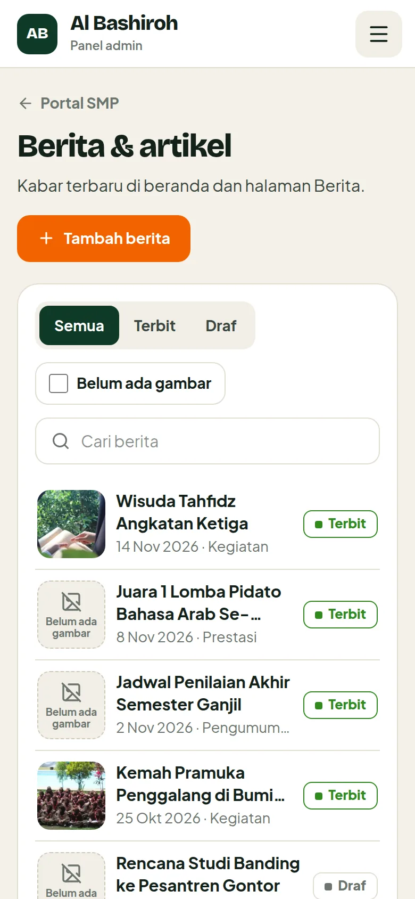
</p>

## The public site

The Yayasan site is served at the root (`/`, `/profil`, `/takhosus`,
`/keasramaan`, `/berita`, `/ppdb`, ...) and each school's portal under `/smp`
and `/sma`. Every page is listed once in `src/app/site-map.ts`, which both
sides read: the browser router builds its routes from it, and the server uses
it to answer each address with its own title, description, canonical link and
link-preview tags, a `404` status for an address the site does not have (or an
article that is not published), and `/sitemap.xml` with every published
article. `/robots.txt` keeps `/admin` and `/login` out of search engines.
Canonical and preview links use `APP_URL`, so set it to the public address
(`https://albashiroh.sch.id`).

Home pages ship in the first download; inner pages and the whole admin panel
load on first visit, so a visitor never downloads the editor. A missing photo
is drawn as a solid block in the section's colour carrying the entry's title.
Accent words in a home page's headline are typed between stars in
**Pengaturan portal**, as in `Generasi Qur'ani yang *bertaqwa*`.

The first download of any public page holds only the site's own code: the
admin frame, its component kit and the feature components behind the admin
pages load with the first admin page. `tests/v3/frontend-build.test.ts` builds
the app and fails if any of them reaches the public entry. An address with a
trailing slash answers `301` to the same address without it.

<p align="center">
  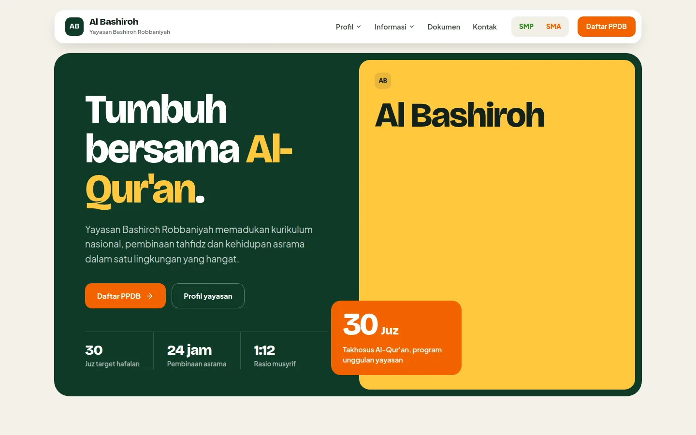
  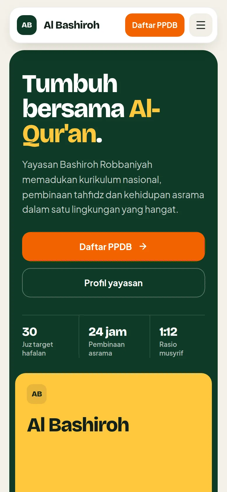
</p>
<p align="center">
  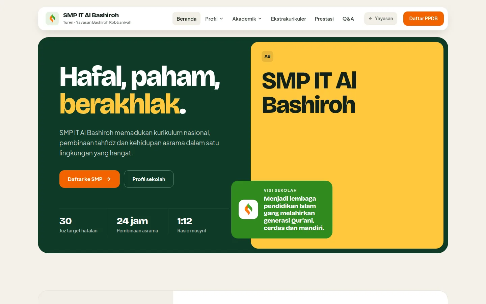
  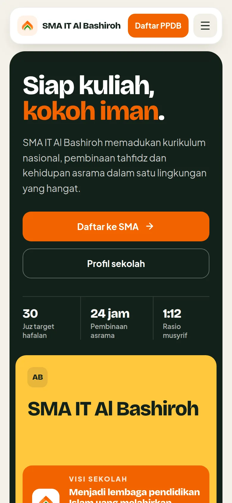
</p>
<p align="center">
  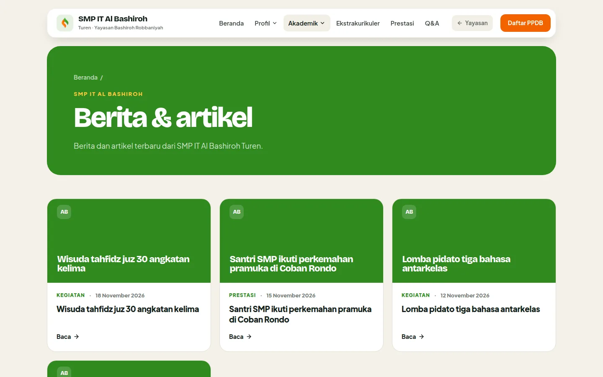
  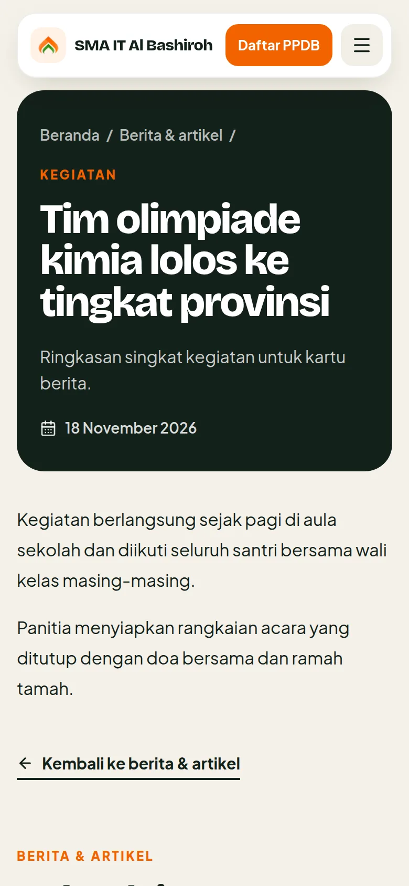
</p>

## PPDB

Families register online on `/ppdb`: they pick SMP or SMA and fill in the
student, both parents, the address and phone number, whether the student will
board, and how the registration fee is paid (the fields of the school's
earlier Tally form). The browser checks the form with the same rules as the
server. A registration gets a number per level and year (`SMP-2026-0001`), and
the same NISN cannot register twice for one level in a year. Spam is held off
without a puzzle: a hidden field only scripts fill in, a signed form token that
must be at least 5 seconds old and at most 12 hours, and at most
`PPDB_SUBMIT_MAX` registrations (default 5) per address per hour.

The form is closed until someone with `ppdb.manage` opens it in **PPDB →
Pengaturan formulir**, where they also set the academic year and, per level,
what a family reads once registered (payment and next steps, plain text) and
the parents' WhatsApp group link. Nothing about payment or contacts is kept in
the code.

**PPDB** in the admin lists the registrations by level, status and search, and
downloads them as Excel or CSV with the same filter (NIK, NISN and phone stay
text in Excel; CSV cells cannot run as formulas). A registration's page shows
everything the family sent, a WhatsApp link, and its status (**Baru**,
**Diverifikasi**, **Diterima**, **Tidak diterima**) with a committee note.
The role `panitia-ppdb` holds `ppdb.view` and `ppdb.manage`; a role with only
`ppdb.view` can read and download but not change anything. Reviews, deletions,
downloads and form changes are recorded in **Aktivitas**.

## Checks

```bash
npm run verify      # the pull-request gate: typecheck, tests, build, architecture
npm run check       # the full suite, run on main
```

Enable the pre-push hook once per clone, so `verify` runs before every push:

```bash
git config core.hooksPath .githooks
```

## Production

Production is one Node process behind a reverse proxy that holds the TLS
certificate, with the SQLite database and uploaded files on the same host:

```bash
cp .env.production.example .env.production
npm ci
npm run build
npm run setup
npm start
```

Behind the proxy set `HOST=127.0.0.1` and `TRUST_PROXY=true`. The database is
backed up every 24 hours into `database/backups/` (the newest 7 are kept);
copy that directory and `storage/` off the host as well.
[`docs/deployment.md`](./docs/deployment.md) walks through a deployment with
Caddy.

## Documentation

- [`CONTRIBUTING.md`](./CONTRIBUTING.md): branches, pull requests, checks and releases
- [`ARCHITECTURE.md`](./ARCHITECTURE.md): Nara's feature model, which this code follows
- [`docs/feature-model.md`](./docs/feature-model.md): Feature ownership and boundaries
- [`docs/auth.md`](./docs/auth.md): sign-in, roles and permissions
- [`docs/database-lifecycle.md`](./docs/database-lifecycle.md): migrations, seeds, backups and restore
- [`docs/deployment.md`](./docs/deployment.md): production behind Caddy or nginx
- [`SECURITY.md`](./SECURITY.md): reporting a vulnerability and the security model
- [`CHANGELOG.md`](./CHANGELOG.md): what changed in each release

## License

[MIT](./LICENSE)
